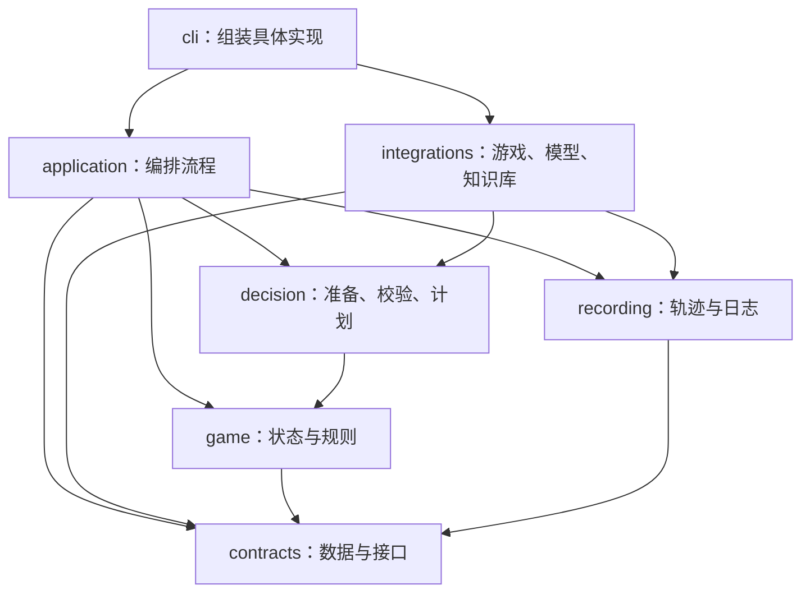

# 源码架构与维护指南

项目采用按业务分组的单进程架构。`cli.py` 负责启动和组装具体实现；游戏规则、决策流程、外部接入、记录分别集中在自己的包中。

## 目录职责

```text
src/sts2_advisor/
  cli.py                      # 参数、配置和依赖组装
  contracts.py                # 跨模块数据与接口协议
  application/
    advisor.py                # 读取 → 准备 → 建议 → 校验 → 执行
  game/
    state.py                  # 原始状态规范化、会话 StateBuilder
    deck.py                   # 本局牌组观测与已确认的变更
    candidates.py             # 当前界面的合法动作
    combat/
      facts.py                # 从当前牌面和意图提取事实
      effects.py              # 已支持的效果及费用
      state.py                # EnemyState、CombatState、TurnOutcome
      simulation.py           # 按动作改变模拟状态
      search.py               # 有预算的出牌顺序搜索
  decision/
    context.py                # 模型输入、实例级图鉴缓存
    metrics.py                # 模型候选的动态数值
    prompts.py                # 提示词、输出契约
    parsing.py                # 模型输出解析
    validation.py             # 建议合法性及解释字段
    plan_check.py             # 逐步资源、手牌、目标检查
    plans.py                  # 短计划复用和失效
    policy.py                 # 不可执行计划的修复政策
    render.py                 # 控制台建议展示
  integrations/
    sts2/
      client.py               # 读取游戏接口
      actions.py              # 动作发送、预检和去重
    models/
      remote.py               # OpenAI 兼容后端
      local.py                # Transformers 后端
      rules.py                # 简单规则回退
    knowledge/
      factory.py              # 组合不同检索后端
      sqlite.py               # 游戏事实检索
      lexical.py              # JSONL 检索与显式关闭
      chroma.py               # 向量检索
      embeddings.py           # 嵌入模型与缓存配置
      common.py               # 文档解析、元数据过滤
      seeds.py                # 基线规则注入
      ingest.py               # 攻略入库命令
  recording/
    trajectory.py             # SQLite 原始轨迹、导出命令
    session.py                # 兼容 JSONL 会话摘要
    logging.py                # 运行日志
    stats.py                  # 战绩统计
  record.py                   # 兼容原 python -m 命令，只有转发
  ingest.py                   # 兼容原 python -m 命令，只有转发
```

测试仍集中在 `tests/`，工具和固定日志评估分别在 `tools/` 与 `evals/`。增加测试时使用新模块路径；不为已经迁移的内部模块添加根目录别名。

## 依赖方向



约束：

- `game` 只能依赖标准库、本包和 `contracts`。卡牌计算内部不读取数据库、不调用模型、不发送游戏动作。
- `application` 和 `decision` 不导入具体 `integrations` 实现。启动入口创建后端、检索器和动作执行器，通过 `AdvisorBackend`、`Retriever`、`GameClient`、`ActionExecutorPort`、`DecisionRecorder` 等协议传入。
- `recording` 只依赖标准库、自己的模块与共享契约，不回调业务实现。
- 内部模块依赖必须无环。可选 SDK 只在实际创建对应后端时加载，导入 CLI 不加载 torch、transformers、openai 或 chromadb。

这些规则由 `tests/test_architecture.py` 自动检查。新增依赖先判断它属于哪条边，不通过放宽测试来回避错误依赖。

## 关键数据与状态归属

API 返回的原始字典在接入和规范化边界保留，便于兼容模组字段并完整记录。进入战斗模拟后使用明确的数据类型：`EnemyState` 表达敌人，`CombatState` 表达模拟局面，`TurnOutcome` 表达结果，`PlanCheck` 表达计划错误或重新观测边界。输出给提示词和报告时再转换成字典。

每个运行会话拥有自己的 `StateBuilder`，内部保留牌组观测；CLI 将同一个实例交给主流程和动作预检，保证两边计算的决策 ID 一致。原始状态和增强后的上下文分别记录。

每个模型后端拥有自己的 `CodexCache`。不使用模块级可变图鉴，不同后端实例不会共享卡牌条目。直接使用提示词辅助函数时可显式传入缓存，省略则本次独立构建。

## 按需求找代码

| 想修改什么 | 首先看哪里 |
|---|---|
| 增加一个卡牌效果 | `game/combat/effects.py`、`simulation.py`，添加实际局面回归 |
| 修正伤害、格挡或意图解析 | `game/combat/facts.py` |
| 调整当前回合搜索排序 | `game/combat/search.py` |
| 某个界面缺少合法动作 | `game/candidates.py` |
| 改牌组跨界面跟踪 | `game/deck.py` |
| 调整模型看到的信息 | `decision/context.py`、`metrics.py` |
| 改选牌解释要求或提示词 | `decision/prompts.py`、`validation.py` |
| 修复重复出牌、超能量计划 | `decision/plan_check.py`、`plans.py` |
| 增加模型后端 | `integrations/models/`，实现 `AdvisorBackend`，在 CLI 组装 |
| 修改知识检索方式 | `integrations/knowledge/` |
| 修改日志、导出或统计 | `recording/` |

## 当前能力边界

牌组观测来自首次看到一场战斗时的手牌、抽牌堆、弃牌堆和消耗堆。保留这个快照可避免能力牌打出后被误删；后续新增战斗牌另列。自动动作成功且后续状态发生变化后，跟踪可识别的拿牌、购买、单张升级或移除。下场战斗重新校正。开局生成牌、半途接入和未能识别的变更仍需明确标记来源和不确定性，卡牌事实库不能替代本局持牌观测。

战斗计算当前支持普通打击、防御、痛击、挑衅、铁斩波、全身撞击、燃烧，以及已覆盖的易伤、人工制品、荆棘和部分遗物。遇到未支持的机制就形成重新观测边界。搜索最多 2,000 个节点、7 张牌、5 个结果，按当前回合生存、掉血、击杀和输出排序，未证明长期最优。

费用计算、模型后的计划校验、计划复用共用同一套纯函数。未来若增加 function calling，只为已有计算器增加工具适配器，不另写一套费用或卡牌规则。

现已增加 `decision/tools.py` 适配器：绑定当前 `DecisionContext`，验证决策 ID、参数、候选与步数，调用共用的 `check_plan` 和模拟器；它不依赖 SDK、网络或动作发送器。`integrations/models/remote.py` 负责 Chat Completions 的工具消息循环、预算和 reasoning 回传。协议参照 [DeepSeek Tool Calls](https://api-docs.deepseek.com/guides/tool_calls/)。默认启用，`OPENAI_FUNCTION_CALLING=false` 可关闭；每次决策最多 3 轮、8 次调用，不自动执行模型提交的试算序列。尚未支持的牌、药水或机制仍返回未知，不宣称完成完整游戏模拟。

## 验证与后续扩展

```powershell
$env:PYTHONUTF8="1"
$env:PYTHONPATH="src;tests;."
.venv\Scripts\python.exe -m unittest discover -s tests -q
.venv\Scripts\python.exe evals/replay.py --output tmp/decision-replay.json
```

本次结构调整保留命令行参数、动作协议、数据库格式以及原 `python -m sts2_advisor.record` / `ingest` 入口。内部 Python 导入路径已迁移，个人脚本若导入旧的 `model`、`retrieval` 等内部模块，需要按上表更新。

增加新能力时先找到负责的模块与对应测试；出现第二个真实实现需求，再提取共用接口。网页端或多个客户端确实需要服务端时，可以在这些接口之外增加 HTTP 层。固定局面比较与局限见 [离线评估](../evals/README.md)，运行方式见 [README](../README.md)。
